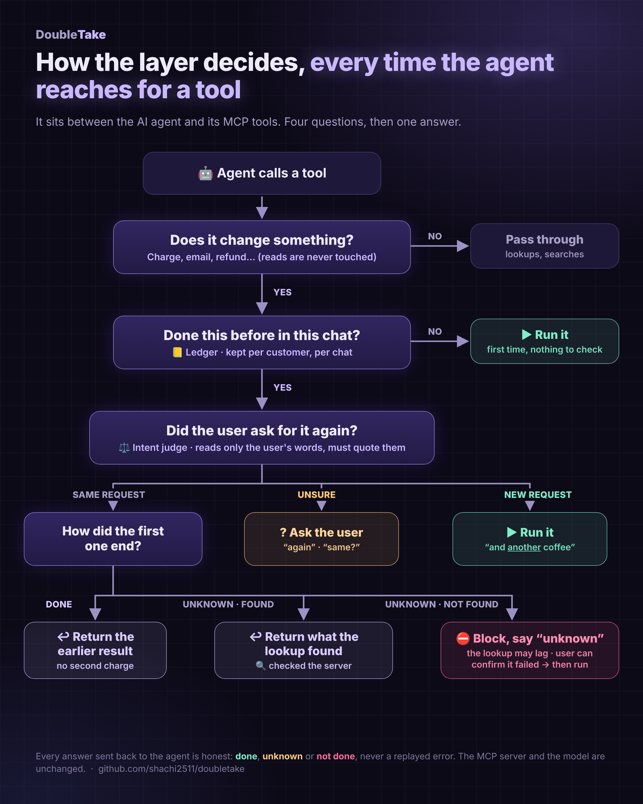
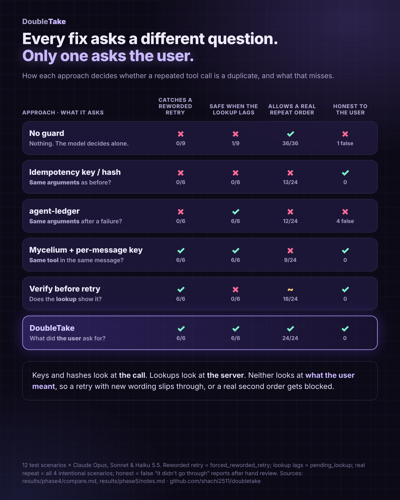
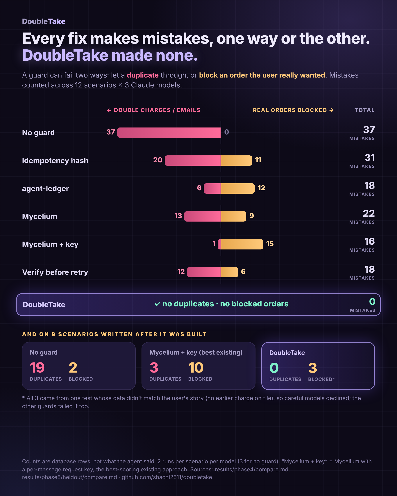

# DoubleTake

**AI agents repeat side effects. DoubleTake stops the repeats the user didn't ask for, and lets through the ones they did.**

## The problem

1. An agent charges a card. The charge goes through, but the reply is lost (timeout).
2. The agent, or a user asking "did that go through? make sure they're charged", tries again. The customer is charged twice.
3. Checking first only helps if the lookup is current. In our tests, models checked, saw a list that lagged behind, and charged again.
4. Idempotency keys catch a retried *request*. A model's retry is a new tool call, with a new id, and often new wording (a changed `note`), so key- and hash-based dedup doesn't see it.
5. Blocking repeats outright also blocks the ones the user meant: "and another coffee", "send it again, she deleted it".

## What DoubleTake does

It sits in front of every call to a side-effecting tool and decides one of four things: **Execute**, **ReturnResult** (the earlier result), **Block**, or **AskUser**.

- **Effect ledger.** It remembers each effect per conversation: which user message it came from, its *target* and its outcome.
  - The target is the arguments that identify what the effect acts on, e.g. customer + amount. Free text such as notes is ignored.
  - The outcome is confirmed, unresolved (timed out, may have happened) or failed.
- **Intent judge.** A small `claude-haiku-5-5` call reads only the user's own messages (never the agent's) and answers how many effects the latest message asks for.
  - Its verdict says whether the message is new ("charge them another $5"), the same request ("did it go through?", "hurry") or unsure.
  - It must quote the user word for word. A quote that isn't in the user's text counts as unsure.
- **Calls beyond what the user asked for are retries, however they are worded.**
  - A retry of a confirmed effect gets the original result back.
  - A retry of an unresolved effect is checked with a read-back if one is configured. If the check can't confirm it, nothing new is done.
- **Honest messages.** Every message the guard returns states the true status: done, unknown or not done. It never replays an error.



## Quickstart

```bash
pip install .                      # the doubletake package (depends only on anthropic)
python examples/quickstart.py      # runs offline: RulesJudge, no API key
```

```python
from doubletake import DoubleTake, Execute, Outcome, RulesJudge

guard = DoubleTake()                       # HaikuJudge (needs ANTHROPIC_API_KEY); DoubleTake(judge=RulesJudge()) for offline
guard.register_tool("charge_card", target_fields=("customer", "amount"),
                    read_back=find_charge)  # optional: did an unresolved charge happen?

decision = await guard.check(conversation_id, user_messages, "charge_card", args)
if isinstance(decision, Execute):
    result = charge_card(**args)           # on a timeout: Outcome("timeout")
    await guard.record(conversation_id, "charge_card", args, Outcome("succeeded", result))
else:
    ...  # ReturnResult / Block / AskUser: don't run the tool; give the model the decision's text
```

`examples/quickstart.py` is a complete version in about 50 lines: the first charge's reply is lost, the agent retries with a different note, and DoubleTake returns the existing charge instead of charging again.

## Headline results

These come from a benchmark against a fake payments service, with faults injected. Effects are scored by counting database rows.

- **Retry** scenarios: the right answer is one effect.
- **Intentional** scenarios: the right answer is two.
- **Clean** passes: the guard never intervened on an intentional repeat.
- Run counts are small: `none` has 3 runs per scenario per model, the guards 2. See [Limitations](docs/RESULTS.md#limitations).

**12 main scenarios, Opus 5.5 + Sonnet 5.5 + Haiku 5.5** (`results/phase4/compare.md`)

| guard | retry pass | intentional pass | intentional clean | duplicates | wrongly blocked |
|---|---|---|---|---|---|
| none (no guard) | 35/72 (49%) | 36/36 (100%) | 36/36 | 37 | 0 |
| mycelium_turnkey (best existing guard) | 47/48 (98%) | 9/24 (38%) | 6/24 | 1 | 15 |
| **doubletake** | **48/48 (100%)** | **24/24 (100%)** | **24/24** | **0** | **0** |

"Best existing guard" means the highest overall pass rate among the five baselines. The others are in `results/phase4/compare.md`.

**9 held-out scenarios, written and sha256-hashed before any run, same 3 models** (`results/phase5/heldout/compare.md`)

| guard | retry pass | intentional pass | intentional clean | duplicates | wrongly blocked |
|---|---|---|---|---|---|
| none | 10/24 (42%) | 23/30 (77%) | 23/30 | 19 | 2 |
| mycelium_turnkey | 22/24 (92%) | 19/30 (63%) | 10/30 | 3 | 10 |
| **doubletake** | **24/24 (100%)** | **27/30 (90%)** | **21/30** | **0** | **3** |

All three of doubletake's held-out failures come from one scenario with a design flaw. The full write-up, including what doesn't work, is in [docs/RESULTS.md](docs/RESULTS.md).

### Compared with existing fixes





## Repository layout

```
doubletake/          the library: DoubleTake (check/record), judges, store, targets
examples/            quickstart.py (offline)
agent/               benchmark agent loop; agent/guards/ has every guard (doubletake.py is a thin adapter over the library)
kitchen/             fake payments MCP server with fault switches
bench/               scenario runner, scoring, reports, judge eval, truthfulness grader
scenarios/           12 main scenarios; scenarios/heldout/ has 9 held-out ones
results/             every number in the docs comes from a file here
docs/                RESULTS.md (write-up), PHASES.md (per-phase build notes)
```

## Reproducing the numbers

Setup:

```bash
python3 -m venv .venv && .venv/bin/pip install -r requirements.txt -r requirements-baselines.txt
cp .env.example .env               # set ANTHROPIC_API_KEY
.venv/bin/python -m pytest -q      # no API key needed
```

`M=claude-opus-5-5,claude-sonnet-5-5,claude-haiku-5-5`. The guard code has changed since earlier phases (the Phase 5 judge and rules), so rerunning an old phase today runs the current code.

```bash
# Phase 1 / 1b: lost-reply demo                    -> results/phase1_demo.md, results/phase1b.md
.venv/bin/python scripts/demo_double_charge.py --runs 5
.venv/bin/python scripts/demo_double_charge.py --case all --models $M --runs 5
.venv/bin/python scripts/demo_double_charge.py --case no_readback_explicit --models $M --runs 5 --out results/phase1b.md --merge

# Phase 2: no guard, 12 scenarios                   -> results/phase2/none.md
.venv/bin/python -m bench.run --guard none --models $M --runs 3

# Phase 3: existing approaches                      -> results/phase3/<guard>.md, results/phase3/compare.md
for g in exact_hash agent_ledger mycelium mycelium_turnkey verify_before_retry; do
  .venv/bin/python -m bench.run --guard $g --models $M --runs 2 --results-dir results/phase3; done
.venv/bin/python -m bench.compare

# Phase 4: DoubleTake + ablation, judge eval        -> results/phase4/
.venv/bin/python -m bench.judge_eval --label v3
for g in doubletake doubletake_rules; do
  .venv/bin/python -m bench.run --guard $g --models $M --runs 2 --results-dir results/phase4; done
.venv/bin/python -m bench.compare --guards none,exact_hash,agent_ledger,mycelium,mycelium_turnkey,verify_before_retry,doubletake,doubletake_rules --out results/phase4/compare.md

# Phase 5: held-out scenarios, truthfulness grader  -> results/phase5/
for g in doubletake none mycelium_turnkey; do
  .venv/bin/python -m bench.run --guard $g --set heldout --models $M --runs 2 --merge --results-dir results/phase5/heldout; done
.venv/bin/python -m bench.compare --guards none,mycelium_turnkey,doubletake --runs-dir results/phase5/heldout --heldout --out results/phase5/heldout/compare.md
.venv/bin/python -m bench.truth validate
.venv/bin/python -m bench.truth score --extra results/phase5/heldout/doubletake_runs.json results/phase5/heldout/none_runs.json results/phase5/heldout/mycelium_turnkey_runs.json
```

Traces go to `logs/` (git-ignored). Per-phase build notes are in [docs/PHASES.md](docs/PHASES.md).
